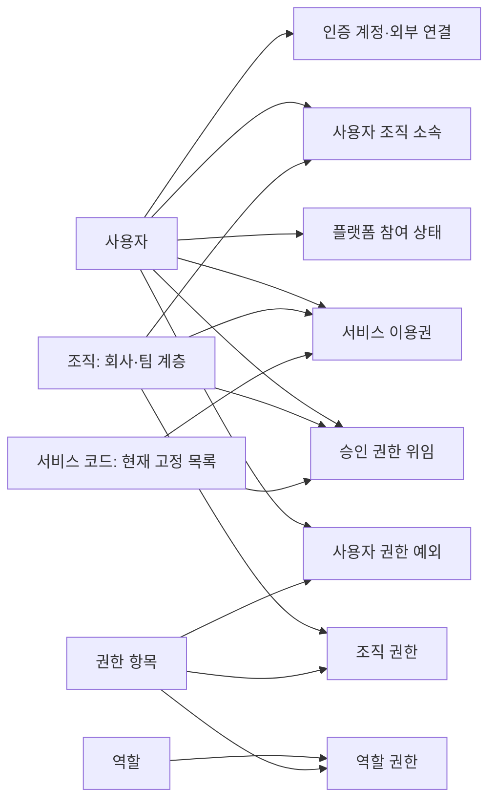

# 플랫폼 운영 마스터·관계·관리 프로그램 목록

> 기준일: 2026-11-03 · 상태: 코드 기반 현황 분석 및 설계 검토안
> 범위: 공통/Admin, CRM, PMS, DMS, SNS. 현재 작업 트리의 미커밋 변경을 포함한다.

2026-11-04 사용자 지시에 따라 첫 적용 범위를 **Admin의 플랫폼 공통 관리**로 한정한다. 현재 적용 경계·우선순위는 [Admin 공통 관리 검토안](2026-11-04-admin-common-management-scope.md)을 따른다. 이 문서의 도메인별 목록과 고객 연결 문제는 전체 조사 자료로 보존하며, 각 앱 특화 관리는 해당 앱의 설정 영역에서 다룬다.

## 1. 목적과 판정 범위

시나리오별로 화면을 추가하기 전에 운영 대상, 원본 데이터, 관계, 관리 책임과 관리 프로그램을 먼저 정한다. 시나리오는 이 프로그램들을 사용하는 순서와 결과를 검증하는 수단이다.

이번 조사는 Prisma 전체 모델 목록, 관련 서버 controller/service, 프론트 route·page·API adapter를 대조했다. **코드에 기능이 있다는 판정은 실제 배포에서 운영 검증을 통과했다는 뜻이 아니다.** DB 실데이터, 현재 사용자별 메뉴 노출, 전체 CRUD·비활성화 영향은 이번에 재검증하지 않았다. 이전 S01 검증 결과는 조직·계정·접근 신청 시나리오의 증거로만 사용한다.

목록의 한 행은 관리 책임 단위다. 한 행마다 새 메뉴·화면·테이블을 만들자는 제안이 아니다. 같은 대상을 다루는 관리자·담당자·본인 화면은 권한과 수행 작업이 다를 수 있다. 원본 데이터와 변경 규칙은 공유해야 한다.

| 분류 | 의미 | 현재 코드의 예 |
|---|---|---|
| 기준 마스터 | 여러 업무가 반복 참조하는 대상 | 조직, 사용자, 고객, 사업장, 시스템 종류, 사업연도 |
| 관계·권한 | 누가 무엇에 어떤 범위로 연결되는지 | 사용자 소속, 역할 권한, 서비스 이용권, 승인 위임 |
| 정책·템플릿 | 동작이나 생성 결과의 기준 | 인증 정책, 산출물/종료조건 그룹, 문서 템플릿, 연계 설정 |
| 업무 데이터 | 업무를 수행하면서 생성·변경되는 기록 | 영업기회, 계약, 프로젝트, 문서, 게시물, 신청·결재 |
| 이력·실행 데이터 | 변경 증거 및 시스템 실행 결과 | 감사 이력, 세션, 메일 발송, 색인 작업, 알림 |

`*_m`이라는 물리 테이블 이름만으로 기준 마스터라고 판단하지 않는다. 예를 들어 `OnboardingRequest`, `ProjectStatus`, `AiIndexJob`는 각각 신청 건, 프로젝트별 단계 상태, 색인 실행 데이터다.

## 2. 마스터와 관리 책임 목록

**표기:** `연결 확인` = 관련 화면과 서버 경로를 코드에서 확인. `부분` = 특정 작업만 존재하거나 UI 연결이 부족. `고정/배포` = 코드·시드·환경설정에서 관리. `검토` = 운영 요구와 소유권을 먼저 결정해야 함. API 경로는 공통 `/api` 접두사를 생략했다. 근거 E 번호는 7절로 연결된다.

### 2.1 공통 기반과 접근 운영

| ID | 관리 대상 / 원본 | 주요 연결 | 필요한 관리 작업 | 현재 프로그램과 판정 |
|---|---|---|---|---|
| P01 | 회사·조직·팀 / `Organization` | 상위 조직, 사용자 소속, 업무 소유 조직 | 등록, 계층 변경, 활성/중지, 구성원·사용처 확인 | Admin `/organizations` → `/organizations` 등록·수정·비활성화 연결 확인. 구성원 수는 있으나 소속 배치 프로그램까지 제공하는 것은 아님. E01/E02 |
| P02 | 사용자·로그인 계정 / `User`, `UserAuth`, `UserExternalIdentity` | 소속, 참여 상태, 역할, 프로필 | 계정 등록·수정·중지·재활성화, 잠금 해제, 세션 회수, 비밀번호 복구 | Admin `/users` → `/users`, `/auth/admin/users/*` 연결 확인. 인사 부서 코드와 승인된 소속은 별개. E02/E03 |
| P03 | 사용자↔조직 소속 / `UserOrganizationRelation` | 주 소속, 리더, 직급, 유효기간 | 배치, 겸직, 전보, 주 소속 변경, 종료, 이력 | **부분.** `/my-organizations`와 `/approvals`의 신청·승인은 있음. 일반 승인 소속의 배치·이동·종료 관리 UI/API는 이번 조사에서 확인하지 못함. migration/bootstrap 계정의 인사정보 bridge는 별도 존재. E03/E04 |
| P04 | 역할·권한 항목·역할별 권한 / `Role`, `Permission`, `RolePermission` | 사용자 기본 역할, 서비스 역할, 도메인 권한 검사 | 역할 정의, 권한 명세, 역할별 허용 기능 설정, 영향 조회 | Admin `/roles` → `/access/ops/roles`, `/catalog`, `/inspect` 연결 확인. **역할별 권한 편집은 있지만 임의 역할/권한 항목의 일반 CRUD는 해당 API에 없음.** E05 |
| P05 | 조직별 권한 / `OrganizationPermission` | 조직↔권한, 유효기간 | 부여·회수·기간 변경·영향 조회 | **부분.** 모델 및 해석/조직 비활성화 처리 존재. 범용 조직 권한 편집 화면·API는 확인하지 못함. 운영자가 편집할 대상인지 먼저 결정. E02/E05 |
| P06 | 사용자 권한 예외 / `UserPermissionException` | 사용자, 권한, 조직/객체 범위, 만료 | 허용·차단 예외, 만료·회수, 사유·감사 | **부분.** Admin `/roles`의 예외 조회 존재. 공통 `/access/ops`는 예외 조회만 제공. 도메인 객체 권한 변경과 공통 예외 직접 편집을 구분해야 함. E05/E11 |
| P07 | 서비스·앱 목록 / 코드 상수와 앱 경로 설정 | 이용권, 승인 위임, 앱 진입, 메뉴 | 서비스 식별자·노출·URL·사용 정책 관리 책임 정의 | **고정/배포.** 이용 신청 대상은 `crm/pms/dms/sns` 상수. 서비스 등록용 DB 마스터·관리 UI는 확인하지 못함. 고정 5앱 운영이면 코드 관리도 가능하며 동적 CRUD가 필수는 아님. E04 |
| P08 | 플랫폼 참여·서비스 이용권 / `PlatformEnrollment`, `ServiceGrant` | 사용자×조직×서비스×역할, 유효기간 | 조회, 발급, 역할 변경, 기간 변경, 회수·재부여 | **부분.** 본인 조회·서비스 신청·승인 있음. 서버 `DELETE /onboarding/grants/:id`는 있지만 Admin participation adapter/화면에 회수 연결 없음. 운영자 이용권 전체 조회·편집 동선도 별도 확인 필요. E04 |
| P09 | 승인 권한 위임 / `ApprovalAuthority` | 담당자×조직×신청 종류×서비스, 승인 가능한 최대 역할 | 담당자 지정·변경·회수·범위 확인 | Admin `/roles`의 승인 권한 위임 → `/onboarding/authorities` 연결 확인. 이는 조직·서비스 신청용이며 전사 결재선 마스터가 아님. E04/E05 |
| P10 | 인증 제공자·가입·복구 정책 / `AuthProviderSetting` 및 배포 설정 | 로그인, 외부 계정 연결, 가입 요청, 메일 발송 | 정책 변경, 제공자 설정, 준비 상태·전송 실패 확인 | Admin `/auth` → `/auth/admin/settings`, 메일 운영 API 연결 확인. 비밀값/배포 설정과 UI 정책의 경계 유지. 모든 인증 기능 구현을 뜻하지 않음. E03 |
| P11 | 코드 그룹·코드 / `CmCode` | 플랫폼/CRM/PMS 코드 소비처 | 등록, 표시명·순서 변경, 비활성화·복구, 참조 확인 | Admin `/codes`, PMS `/admin/code` → 동일 `/codes`. 저장소는 공통이나 코드 의미의 소유자는 도메인별. 같은 API를 사용하는 기존 두 화면은 중복 검토 대상이지 즉시 삭제 대상은 아님. E06 |
| P12 | 메뉴·메뉴 표시 권한 / `Menu`, `RoleMenu`, `UserMenu`와 앱별 route 설정 | 역할/사용자↔메뉴 | 메뉴 등록·배치, 표시 권한, 실제 기능 권한과 정합성 | PMS `/admin/menu`, `/admin/role` → `/menus/admin`, `/roles/:roleCode/menus` 존재. **플랫폼 전체 메뉴 마스터는 아님.** Admin/CRM/SNS 등의 정적 메뉴와 별도 체계. E01/E07 |
| P13 | AI 소스·제공자·모델 운영 기준 / `AiSource` 및 배포 설정 | 도메인 adapter, 색인, 검색·AI 기능 | 소스/모델 책임, 준비 상태, 실행 정책 관리 | Admin `/ai-operations` → `/ai-index/*` 운영 상태·작업 실행 연결 확인. 제공자/모델/프롬프트/에이전트 종합 CRUD는 아님. 소스 등록과 비밀값은 코드·배포 경로를 구분. E13 |

### 2.2 고객·영업·수행 기준

| ID | 관리 대상 / 원본 | 주요 연결 | 필요한 관리 작업 | 현재 프로그램과 판정 |
|---|---|---|---|---|
| C01 | 영업 고객 / `CrmCustomer` | 담당 사용자·조직, 원천 영업기회, 고객 활동 | 등록, 수정, 담당 변경, 중복 식별, 종료 | CRM `/customers` → `/crm/customers` 조회·생성·수정 연결 확인. 전용 삭제 API는 없음. PMS 고객과 공통 식별자 계약은 검토 필요. E08 |
| C02 | 사업연도 / `CrmBusinessYear` | 연도별 계획·실적 | 연도 등록, 표시 순서, 활성/중지 | CRM `/business-years` → `/crm/business-years` 관리 연결 확인. 일반 코드 `biz_year`와 분리된 CRM 정본. E08/E06 |
| C03 | 견적 공급자 회사정보 / `CrmQuoteSellerProfile` | 견적·계약 출력, CI 자산 | 회사정보·사업자번호·연락처·CI 관리 | CRM `/quote-settings` → `/crm/quote-seller-profile` 조회·저장·CI 업로드 연결 확인. 공통 조직과 별도 모델이며 회사정보 자동 동기화로 간주하면 안 됨. E08 |
| C04 | CRM 문서·수행·회계 연계 정책 / `CrmConfig` | DMS 템플릿 키, 인계 사용 여부, 재처리 기준 | 정책 변경, 버전·이력, 사용처 확인 | CRM `/operations/settings` → `/crm/settings` 조회·저장·이력 연결 확인. 설정 저장 가능과 외부 연계 실제 가동은 별도 검증. E08 |
| C05 | AMS 원천 업체·WBS 대응 / `CrmCostPlanAmsSourceVendor`, `CrmCostPlanAmsSourceVendorWbs`, `CrmCostPlanAmsVendorWbsMapping` | 원가계획, 계약/WBS, 외부 원천 | 원천 동기화와 수동 매핑의 소유권·변경 책임 정의 | `/cost-plan` 및 cost-plan 모듈에 존재. **검토.** 전사 협력사 마스터와 동일시하지 않으며 세부 관리 동작은 별도 검증 대상. E08 |
| M01 | 수행 고객 / `Customer` (`pms.cm_customer_m`) | 사업장, 시스템 인스턴스, 프로젝트, legacy 사용자 bridge | 등록, 수정, 병합/연결, 중지 | **부분.** `/customers` API는 목록·상세 조회만. PMS 기준정보 화면에서도 고객은 선택 데이터. `CrmCustomer`와 별도 모델이며 공통 고객 관리 책임 공백을 우선 검토. E07/E14 |
| M02 | 사업장·플랜트 / `PlantSite` | 고객↔사업장↔시스템 인스턴스 | 등록·수정·비활성화, 고객 연결, 일괄 등록 | PMS `/admin/master`의 플랜트/사이트 → `/master/sites` 연결 확인. E07 |
| M03 | 시스템 종류 / `SystemCatalog` | 상하위 분류↔시스템 인스턴스 | 종류·계층 등록·변경·중지 | 동일 화면의 시스템 종류 → `/master/system-catalogs` 연결 확인. E07 |
| M04 | 실제 운영 시스템 / `SystemInstance` | 고객, 사업장, 종류, 프로젝트, 인터페이스 | 식별·배치·환경·운영상태 변경·중지 | 동일 화면의 시스템 인스턴스 → `/master/system-instances` 연결 확인. E07 |
| M05 | 시스템 간 인터페이스 / `SystemIntegration` | 출발·도착 시스템 인스턴스 | 연결 등록, 방향·방식·상태 변경·중지 | 동일 화면의 인터페이스 → `/master/integrations` 연결 확인. E07 |
| M06 | 기준정보 가져오기 매핑 / `PmsMasterImportProfile` | 사업장·종류·인스턴스·인터페이스 입력 | 매핑 저장, 미리보기·적용, 이력·복원 | PMS `/admin/master` → `/master/import`, `/master/import-profiles` 연결 확인. 범용 모든 마스터 import로 확대 해석하지 않음. E07 |
| M07 | 산출물 기준·그룹 / `Deliverable`, `DeliverableGroup`, `DeliverableGroupItem` | 프로젝트별 산출물, 단계 | 항목·그룹 구성, 승인·보관·이력·복원 | PMS `/admin/templates` → `/pms/template-groups/deliverables` 연결 확인. 문서 본문의 DMS 템플릿과 역할이 다름. E09 |
| M08 | 종료조건 그룹 / `CloseConditionGroup`, `CloseConditionGroupItem` | 프로젝트별 종료조건·단계 완료 | 그룹 구성, 승인·보관·이력·복원 | 동일 화면 → `/pms/template-groups/close-conditions` 연결 확인. 실제 프로젝트 체크/결재 기록과 구분. E09 |
| M09 | 프로젝트 역할 권한 / `ProjectRolePermission` 및 역할 코드 | 프로젝트 구성원↔프로젝트 기능 | 역할별 업무 권한 기준 관리 | 모델·권한 소비 구조 존재. PMS `/admin/role`은 메뉴 표시 권한이므로 이것의 편집 프로그램으로 세면 안 됨. 전용 정책 편집은 **검토**. E01/E07 |

### 2.3 문서·협업 기준

| ID | 관리 대상 / 원본 | 주요 연결 | 필요한 관리 작업 | 현재 프로그램과 판정 |
|---|---|---|---|---|
| D01 | 문서 템플릿 / `DmsTemplate` + 문서 저장소 파일 | 생성 문서, CRM 템플릿 키, 범위·소유자 | 등록·갱신·삭제, 검토 확인, 원본 파일 관리 | DMS `/settings/management/templates` → `/dms/templates` 연결 확인. DB 메타데이터와 파일 본문을 함께 관리. E10 |
| D02 | 문서 시스템 정책 / `DmsConfig` + runtime 설정 | 저장소, 수집, 업로드, 검색, AI 보조·추출 | 정책 저장, 적용 상태·오류 확인 | DMS `/settings/system-settings/*` → `/dms/settings`. 저장소/Git 경로 관측은 `/settings/operations/*`로 별도 존재. 모든 runtime 경로가 UI에서 수정되는 것은 아님. E10 |
| D03 | 계약 문서 결재선·산출 정책 / DMS 설정 | CRM 계약 문서, 승인 역할, 산출 경로 | 정책·버전·조직 범위·역할·산출 경로 관리 | DMS `/settings/management/crmContractApprovalRoute`, `/crmContractExportPolicy` 섹션 연결 확인. CRM 내부 계약 승인 및 P09와 서로 다른 책임. E10 |
| D04 | 문서 접근 관계 / `DmsDocumentGrant`, 문서 소유·공개범위 | 사용자/조직↔문서 | 직접 부여·요청 승인·회수·소유권 이전 | DMS `/settings/management/documentAccess` 및 문서 권한 패널 → `/dms/access/grants`, `/dms/access/requests` 연결 확인. 접근 신청 자체는 업무 기록. E11 |
| S01 | 게시판 / `SnsBoard` | 게시판 분류, 게시물 | 생성·수정·중지·정렬 | SNS `/board` 목록·생성 UI와 `/sns/boards` CRUD API 존재. **부분:** 수정·삭제 adapter는 있으나 해당 작업을 호출하는 UI는 검색에서 확인하지 못함. E12 |
| S02 | 게시판 내 분류 / `SnsBoardCategory` | 게시판↔분류↔게시물 | 분류 등록·수정·정렬·중지 | 모델 존재. board controller에는 분류 CRUD 없음. 운영 관리 경로는 **검토**. E01/E12 |
| S03 | 스킬 사전 / `SnsSkill` | 상위 스킬, 동의어, 사용자 스킬, 전문가 검색 | 등록·정규화·수정·병합·중지 | `/sns/skills` 조회·생성, 전문가 검색 존재. 프론트 skills adapter는 목록·검색·추천 중심. 일반 사전 편집 프로그램은 **부분**. E12 |
| S04 | 태그 사전 / `SnsTag` | 게시물 태그 관계 | 자동 생성과 운영 정리의 책임, 동의어·중복 처리 | 게시물 태그 모델 존재. 전용 관리 controller/화면은 확인하지 못함. 자유 태그 운영이면 별도 메뉴가 필요한지는 검토. E01/E12 |
| S05 | 사용자 프로필·스킬·경력 / `SnsUserProfile`, `SnsUserSkill`, `SnsUserCareer` | 공통 사용자, 스킬 사전, 경력 프로젝트 | 본인 프로필·스킬·경력 관리, 계정정보와 정합성 | 공용 사용자 화면과 SNS profile/skill API 연결. 본인 관리 데이터이며 Admin 사용자 마스터와 편집 책임을 구분. E12/E15 |

**36개 관리 책임 단위의 초안이다. 새 화면 36개를 뜻하지 않는다.** 읽기 전용·코드 고정 항목에 무조건 CRUD를 추가하지 않는다. 거래처 통합, 권한 정책, 관계의 생명주기를 결정한 후 기존 프로그램의 재사용·보완 범위를 산정한다.

## 3. 데이터 연결성

### 공통 기반의 현재 논리 관계

이 그림은 논리적 연결이며 모두 DB FK라는 뜻은 아니다. `User.roleCode`, `ServiceGrant.roleCode`, `ApprovalAuthority.maxRoleCode`의 역할과 적용 범위가 다르다. 소속 승인, 서비스 입장 허용, 업무 기능 권한, 객체 접근 권한이 각각 어떤 조건을 담당하는지 따로 검증해야 한다.

### 업무 기준의 연결과 확인된 단절

| 연결 | 코드상 현재 형태 | 설계에서 확정할 사항 |
|---|---|---|
| 조직 ↔ 고객 ↔ 견적 공급자 | `Organization`, `Customer`, `CrmCustomer`, `CrmQuoteSellerProfile`이 별도 모델 | 법인/조직/거래처/출력용 회사정보의 차이, 동일 법인 식별 방식과 변경 책임. 이름이 같다고 자동 병합하지 않음 |
| PMS 고객 → 사업장 → 운영 시스템 | `customerId`, `siteId`, `systemCatalogId`로 연결 | 기준정보 등록 순서, 고객 등록 경로, 부모 중지 시 신규 연결 금지와 기존 이력 유지 |
| 운영 시스템 → 인터페이스 / 프로젝트 | 인터페이스의 출발·도착 ID, 프로젝트 `systemInstanceId` | 시스템 교체·폐기 시 연결 변경 책임, 과거 프로젝트 참조 보존 |
| CRM 고객 ↔ 영업기회·계약 | 고객은 원천 기회를 참조 가능. 영업기회·계약은 `customerName`을 저장하며 `CrmCustomer.id` 직접 참조 필드가 없음 | 고객명 snapshot인지 고객 정본 참조인지 구분. 동명이인/동명회사·명칭 변경·병합 시 처리 규칙 |
| 조직·사용자 → CRM/PMS/DMS 업무 | `ownerOrganizationId`, 담당자·소유자 ID, 프로젝트 조직/구성원, 문서 대상 조직 | 소속 이동·퇴사·조직 폐쇄 시 업무 인계와 권한 회수 범위 |
| PMS 기준 그룹 → 프로젝트별 항목 | 기준 그룹과 실제 산출물·종료조건 관계가 별도 모델 | 기준 개정이 기존 프로젝트에 소급되는지, 적용본/승인 이력 보존 |
| CRM 정책 → DMS 템플릿·산출 정책 | template key, 계약 문서 lifecycle 정책으로 연결 | 유효한 템플릿만 선택, 비활성화 영향, 정책 개정과 기존 계약 문서의 재현성 |
| 사용자 → SNS 프로필 → 스킬 | 공통 사용자와 도메인 프로필/스킬 관계 | 계정 상태·공용 표시정보와 본인 경력/스킬 수정의 책임 구분 |

스키마에는 `Project.ownerOrganization`, `DmsDocument.ownerUser` 같은 스키마 간 명시적 관계도 있다. 따라서 기존 지침의 “스키마 간 FK 금지”만 보고 실제 연결을 전부 애플리케이션 조인이라고 기술해서는 안 된다. FK·논리 ID·코드·문자열 snapshot을 상세 데이터 사전에서 구별해야 한다.

## 4. 마스터 관리와 분리해서 목록에 넣을 운영 프로그램

| 운영 프로그램 | 사용하는 기준 데이터 | 현재 구현 위치와 경계 |
|---|---|---|
| 가입 요청 처리·계정 복구 | 사용자, 인증 정책 | Admin 사용자/인증 운영. `UserRegistrationRequest`, 세션, 복구 challenge, 메일 outbox는 업무/실행 기록 |
| 소속·조직·서비스 신청 처리 | 조직, 사용자, 이용권, 위임 | 현재 세 메뉴와 `/onboarding`. `OnboardingRequest`는 신청 기록이며 신규 마스터가 아님 |
| 계약 내부 승인 | CRM 계약, 승인자 | CRM contract-approval. 공통 신청 승인 화면이 전체 계약 승인을 처리하는 구조가 아님 |
| 문서·게시물 접근 신청 | 객체, 소유자, 권한 관계 | DMS access, SNS post-access. 동일한 “승인” 명칭만으로 계약/소속 승인과 합치지 않음 |
| 프로젝트 완료·산출물 승인 | 산출물·종료조건 기준, 구성원 | PMS deliverable/close-condition/closeout-approval. 프로젝트별 적용 결과는 거래 데이터 |
| 인계·수집·색인·메일 재처리 | 연계 정책, 소스, 인증/문서 정책 | CRM operations, DMS operations, Admin AI/auth. 실패 원인·재시도·중복 방지가 운영 기능 |
| 변경 이력·권한 진단 | 각 마스터 및 관계 | 공통 감사와 도메인 이력. 이력 테이블 존재만으로 사용자용 조회·복원 프로그램이 있다고 판정하지 않음 |

따라서 화면의 정리 기준은 **업무 대상 + 수행 작업 + 담당 권한**이다. 목록/상세/선택/이력 UI는 재사용할 수 있지만 서로 다른 승인 규칙을 하나의 범용 결재 엔진으로 바꾸는 것은 별도 설계 결정이다.

## 5. 기존 세 메뉴의 재평가

| 현재 메뉴 | 실제 데이터·행위 | 이번 분석에서의 위치 |
|---|---|---|
| 내 소속 | 본인 소속 조회, 소속/조직 생성 신청, 신청 취소·결과 | P01/P03의 본인용 조회·신청 진입점. 조직 소속 운영 전체를 제공하지 않음 |
| 서비스 이용 | 본인 서비스 이용권 조회, 신청, 앱 진입 | P07/P08의 본인용 진입점. 서비스 마스터·이용권 관리 콘솔이 아님 |
| 신청 승인 | 위임 범위 내 조직/소속/서비스 신청 승인·반려 | P03/P08/P09에 따른 요청 처리함. 전 플랫폼 결재함이 아님 |

세 메뉴가 모두 불필요하다는 결론도, 그대로 최종 메뉴라는 결론도 아직 내리지 않는다. 마스터와 관계의 운영 프로그램을 확정한 후 본인·관리자·승인자의 진입점을 배치한다. 이번 작업은 화면·메뉴를 추가/삭제/통합하지 않는다.

## 6. 설계 우선순위와 다음 검증 단위

1. **데이터 소유권 확정:** 회사·조직·고객·공급자 회사정보의 경계, 공통 식별자/도메인별 ID 연결, 코드·서비스·역할의 변경 책임을 정한다.
2. **운영 생명주기 완성도 평가:** 조직 신설만 아니라 개편/폐쇄, 계정 생성만 아니라 전보/퇴사, 이용권 발급만 아니라 역할 변경/만료/회수까지 P01~P09를 상세 명세한다.
3. **기존 프로그램 매핑 확정:** 36개 책임별로 목록·등록·수정·중지·복구·연결·이력·일괄처리 중 필요한 작업과 현재 제공 작업을 대조한다. 필요 없는 작업은 명시적으로 제외한다.
4. **프로그램 구성 설계:** 기존 화면 보완, 같은 원본의 다른 권한 관점, 도메인 전용 기능을 구별해 메뉴를 결정한다. 데이터 테이블 수나 시나리오 수로 화면 수를 정하지 않는다.
5. **시나리오 연결:** 확정된 프로그램 ID를 사용해 `담당자 → 메뉴/작업 → 입력 → 바뀐 데이터/관계 → 다음 담당자`로 검증한다. 새로운 시나리오를 추가할 때 먼저 기존 프로그램으로 처리 가능한지 확인한다.

각 관리 대상 상세 명세의 공통 필드는 다음과 같다.

| 항목 | 기록할 내용 |
|---|---|
| 식별·책임 | 관리 대상 ID, 정의, 원본 저장소, 식별키, 업무 소유 부서/앱, 실제 운영 담당 역할 |
| 관계 | 부모/자식, 참조 ID·코드·snapshot, 필수 여부, 중복 기준, 외부 연계 원천 |
| 생명주기 | 등록 조건, 수정 가능 범위, 적용일, 비활성화/복구, 참조 중 삭제 제한, 이력 |
| 프로그램 | 기존 route와 API, 사용자별 허용 작업·데이터 범위, 일괄처리·오류 복구 |
| 검증 | 실제 저장·재조회, 다른 앱 반영, 비활성/권한 회수, 기존 거래·감사 보존 |

추가 후보인 독립 협력사/담당자 사전, 근무 달력, 표준 단가, 보존기간 정책 등은 현재 목록에서 보이지 않는다는 이유만으로 구현하지 않는다. 실제 운영 요구와 기존 코드·환경설정 대체 가능성을 먼저 정한다. 배포·백업·복원은 관리 프로그램 외의 운영 절차로 별도 검증한다.

## 7. 코드 근거

링크는 현재 파일 기준이며 코드 존재·연결을 확인하는 자료다. 구현 완료/실운영 합격의 증거를 대신하지 않는다.

| 근거 | 주요 원본 |
|---|---|
| E01 | [Prisma 스키마](../../../../packages/database/prisma/schema.prisma), [Admin 메뉴](../../../../apps/web/admin/src/components/layout/navigation.ts), [CRM route](../../../../apps/web/crm/src/lib/constants/routes.ts) |
| E02 | [조직 API](../../../../apps/server/src/modules/common/access/organization-operations.controller.ts), [조직 service](../../../../apps/server/src/modules/common/access/organization-operations.service.ts), [조직 화면](../../../../apps/web/admin/src/components/pages/organizations/OrgManagementPage.tsx) |
| E03 | [사용자 API](../../../../apps/server/src/modules/common/user/user.controller.ts), [사용자 service](../../../../apps/server/src/modules/common/user/user.service.ts), [사용자 관리](../../../../apps/web/admin/src/components/pages/users/UserManagementPage.tsx), [인증 운영 API](../../../../apps/server/src/modules/common/auth/auth-admin.controller.ts) |
| E04 | [신청·위임·회수 API](../../../../apps/server/src/modules/common/onboarding/onboarding.controller.ts), [승인 service](../../../../apps/server/src/modules/common/onboarding/onboarding.service.ts), [서비스 목록·입장 정책](../../../../apps/server/src/modules/common/onboarding/platform-admission.service.ts), [Admin 연결 API](../../../../apps/web/admin/src/lib/api/endpoints/participation.ts), [본인 서비스 화면](../../../../apps/web/admin/src/components/pages/access/MyServicesPage.tsx) |
| E05 | [권한 운영 API](../../../../apps/server/src/modules/common/access/access-operations.controller.ts), [역할·권한 화면](../../../../apps/web/admin/src/components/pages/roles/AccessManagementPage.tsx) |
| E06 | [코드 API](../../../../apps/server/src/modules/common/code/code.controller.ts), [코드 소유권 정본](common-code-ownership.md) |
| E07 | [PMS 페이지 registry](../../../../apps/web/pms/src/components/layout/ContentArea.tsx), [기준정보 화면](../../../../apps/web/pms/src/components/pages/admin/MasterDataPage.tsx), [기준정보 API](../../../../apps/server/src/modules/pms/master/master.controller.ts), [메뉴 API](../../../../apps/server/src/modules/pms/menu/menu-admin.controller.ts), [역할 메뉴 API](../../../../apps/server/src/modules/pms/menu/role-permission.controller.ts) |
| E08 | [CRM 고객 API](../../../../apps/server/src/modules/crm/customer/customer.controller.ts), [고객 service](../../../../apps/server/src/modules/crm/customer/customer.service.ts), [고객 화면](../../../../apps/web/crm/src/components/pages/customers/CustomerWorkspace.tsx), [사업연도 API](../../../../apps/server/src/modules/crm/business-year/business-year.controller.ts), [견적 회사정보 API](../../../../apps/server/src/modules/crm/quote-settings/quote-settings.controller.ts), [연계 설정 API](../../../../apps/server/src/modules/crm/operations/settings.controller.ts), [원가계획 API](../../../../apps/server/src/modules/crm/cost-plan/cost-plan.controller.ts) |
| E09 | [PMS 템플릿 화면](../../../../apps/web/pms/src/components/pages/admin/TemplateManagementPage.tsx), [템플릿 관리 API](../../../../apps/server/src/modules/pms/deliverable/template-admin.controller.ts) |
| E10 | [DMS 설정 기능 명세](../../../../apps/web/dms/src/components/pages/settings/_config/settingsPageConfig.ts), [설정 경로 생성](../../../../apps/web/dms/src/components/pages/settings/_utils/settingsNavigation.ts), [설정 API](../../../../apps/server/src/modules/dms/settings/settings.controller.ts), [템플릿 API](../../../../apps/server/src/modules/dms/templates/templates.controller.ts) |
| E11 | [문서 접근 운영 API](../../../../apps/server/src/modules/dms/access/access-request.controller.ts), [직접 부여 API](../../../../apps/server/src/modules/dms/access/access-grant.controller.ts), [문서 접근 화면](../../../../apps/web/dms/src/components/pages/settings/_components/DocumentAccessSurface.tsx) |
| E12 | [게시판 API](../../../../apps/server/src/modules/sns/board/board.controller.ts), [게시판 UI](../../../../apps/web/sns/src/components/pages/board/BoardListPage.tsx), [게시판 adapter](../../../../apps/web/sns/src/lib/api/endpoints/boards.ts), [스킬 API](../../../../apps/server/src/modules/sns/skill/skill.controller.ts), [스킬 adapter](../../../../apps/web/sns/src/lib/api/endpoints/skills.ts), [프로필 API](../../../../apps/server/src/modules/sns/profile/profile.controller.ts) |
| E13 | [AI 운영 API](../../../../apps/server/src/modules/common/ai-index/ai-index.controller.ts), [설정 소유권·AI 구현 한계](settings-admin-control-plane.md) |
| E14 | [PMS 고객 조회 API](../../../../apps/server/src/modules/pms/customer/customer.controller.ts), [PMS 고객 조회 hook](../../../../apps/web/pms/src/hooks/queries/useCustomers.ts) |
| E15 | [설정·프로필·계정 책임 경계](settings-admin-control-plane.md), [기존 S01 검증의 범위](2026-10-27-functional-access-management.md) |

## Changelog

| 날짜 | 내용 |
|---|---|
| 2026-11-03 | 5개 앱의 운영 기준을 36개 관리 책임 단위로 분류. 데이터 연결, 기존 프로그램, 운영 공백과 세 메뉴의 역할을 코드 기반으로 정리. 화면·DB·배포 변경 없음 |
